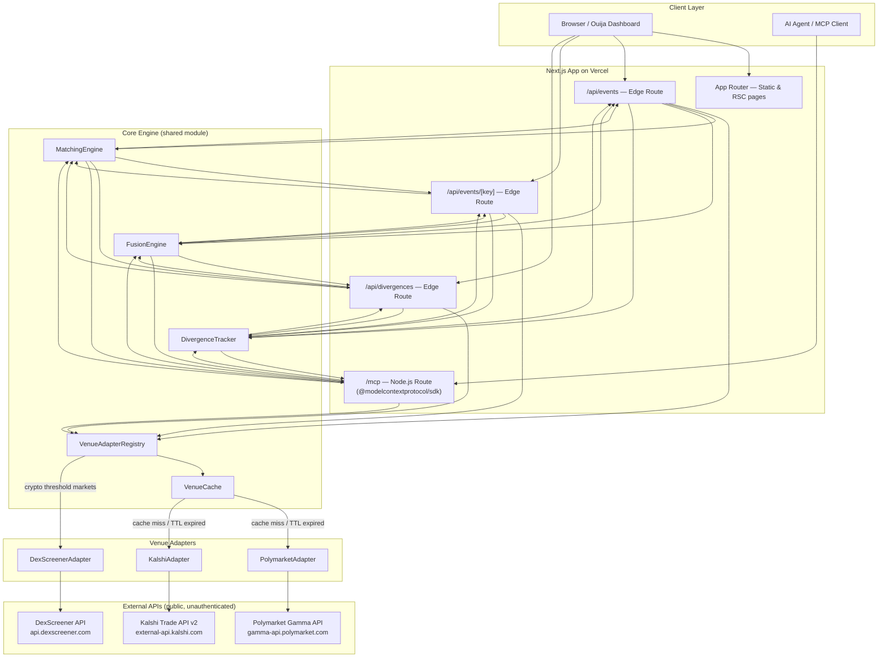
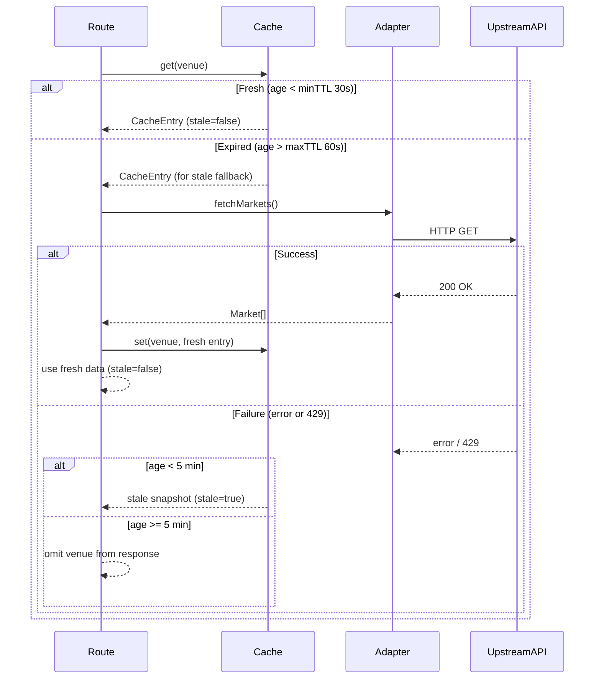

# Design Document

## Overview

Séance is a read-only prediction market aggregator that pulls binary-outcome market data from Polymarket, Kalshi, and DexScreener, fuses per-venue probabilities into a single liquidity-weighted consensus, and surfaces cross-venue divergences through two interfaces: an Ouija-themed web dashboard and a Model Context Protocol (MCP) server for AI agent integration.

The system is entirely serverless. All state lives in an in-process, edge-compatible in-memory cache with configurable TTLs (30–60 s per venue, 5-minute stale fallback). There is no database, no message broker, and no persistent store — the system reconstructs its working state from upstream API calls on each cold start and serves subsequent requests from the cache. This keeps ongoing infrastructure cost at $0 while satisfying the p95 < 800 ms warm-cache latency target.

**Key design decisions:**

- **Next.js 15 App Router on Vercel** — single deployment unit covering both the React dashboard and all API routes; Edge Runtime for read-only data routes, Node.js runtime for the MCP server (which needs the full `@modelcontextprotocol/sdk` package).
- **In-memory cache** — `Map`-based, per-process, keyed by venue. Edge functions run in isolated micro-VMs; the cache is primed on first request and persists for the lifetime of the warm instance. Stale snapshots are served with `stale=true` for up to 5 minutes when a venue fetch fails.
- **No secrets in the repo** — all three upstream APIs (Polymarket Gamma, Kalshi Trade API v2, DexScreener) are unauthenticated public APIs, so no credentials are needed.
- **TypeScript throughout** — shared Zod schemas enforce the normalized `Market` and `Event` shapes at both parse-time and type-time, guaranteeing schema parity between the HTTP API and the MCP server.

---

## Architecture



### Data flow — warm request

1. An HTTP or MCP request arrives at an API route.
2. The route calls `VenueAdapterRegistry.getMarkets()`.
3. The registry checks `VenueCache` for each venue. If the cached snapshot is fresher than the minimum TTL (30 s), it is returned immediately without an upstream fetch.
4. If the TTL has elapsed, the registry spawns concurrent fetch requests to Polymarket and Kalshi. Each adapter fetches, validates against the Zod schema, normalises timestamps to UTC ISO 8601, and returns a `Market[]`.
5. For any `Market` whose title matches the crypto-threshold heuristic, `DexScreenerAdapter.getSpotPrice()` is called and the result is merged into the market object.
6. The normalised markets are written to `VenueCache` with a TTL between 30 s and 60 s. If a fetch fails, the existing snapshot is returned with `stale=true` as long as it is no older than 5 minutes.
7. `MatchingEngine` computes or looks up `Match` records for the current market set.
8. `FusionEngine` computes `ConsensusEvent` objects from confirmed matches.
9. `DivergenceTracker` evaluates the current consensus state and emits or closes `Divergence` records.
10. The route serialises the response using the shared Zod schema and returns it.

---

## Components and Interfaces

### VenueCache

Thin in-memory wrapper around a `Map<VenueName, CacheEntry>`.

```typescript
interface CacheEntry {
  markets: Market[];
  fetchedAt: number;   // Unix ms
  ttlMs: number;       // 30_000–60_000
}

interface VenueCache {
  get(venue: VenueName): CacheEntry | undefined;
  set(venue: VenueName, entry: CacheEntry): void;
  isStale(venue: VenueName, maxAgeMs: number): boolean; // maxAgeMs = 5 * 60_000 for stale fallback
}
```

### VenueAdapterRegistry

Orchestrates all venue adapters and merges results.

```typescript
interface VenueAdapterRegistry {
  getMarkets(): Promise<{ markets: Market[]; errors: VenueFetchError[] }>;
}
```

The registry calls each adapter concurrently using `Promise.allSettled`. Fulfilled results are written to the cache. Rejected results trigger a stale-cache lookup. If no cached snapshot exists and the fetch fails, the venue is omitted from the response (not an error at the API level — only an error if *all* venues fail).

### VenueAdapter (abstract interface)

```typescript
interface VenueAdapter {
  readonly venueName: VenueName;
  fetchMarkets(): Promise<Market[]>;
}
```

**PolymarketAdapter** — calls `GET gamma-api.polymarket.com/markets?active=true&closed=false` (paginated). The "Yes" outcome token price field (`tokens[0].price` where `outcome === "Yes"`) maps to `prob`. Liquidity comes from `liquidityNum`. Resolution timestamp from `endDate`.

**KalshiAdapter** — calls `GET external-api.kalshi.com/trade-api/v2/markets?status=open` (paginated). `yes_bid`/`yes_ask` midpoint maps to `prob`. `volume` maps to `liquidity` (best available proxy). `close_time` from the response is already ISO 8601.

**DexScreenerAdapter** — called on demand for crypto-threshold markets. Extracts the ticker symbol from the market title using a regex (`/\$([A-Z0-9]+)/i` or `/\b([A-Z0-9]{2,10})\s+(?:above|below|over|under|crosses?)\s+\$/i`), then calls `GET api.dexscreener.com/latest/dex/search?q={symbol}` and returns the `priceUsd` from the highest-liquidity pair in the response.

### MatchingEngine

Stateful in-memory store of `Match` records, rebuilt on each cold start from the current market set. Curated matches are loaded from a checked-in JSON file (`/data/curated-matches.json`) that operators can edit without a code change.

```typescript
interface MatchingEngine {
  proposeMatches(incoming: Market[], existing: Market[]): Match[];
  reEvaluate(updatedMarket: Market): void;
  getMatchesForMarket(marketId: string): Match[];
  getCuratedMatchOverride(a: string, b: string): Match | undefined;
}
```

The confidence score formula is detailed in the Data Models section.

### FusionEngine

Pure function module — no internal state.

```typescript
interface FusionEngine {
  computeConsensus(event: EventCandidate): ConsensusEvent;
}
```

### DivergenceTracker

Maintains an in-memory list of `Divergence` records per event, capped at 1,000 per event.

```typescript
interface DivergenceTracker {
  evaluate(event: ConsensusEvent, threshold: number): DivergenceDelta;
  getTopDivergences(limit: number, minGap: number): Divergence[];
  getHistory(eventKey: string): DivergenceRecord[];
}
```

### HTTP API Routes

| Route | Runtime | Description |
|-------|---------|-------------|
| `GET /api/events` | Edge | List all `ConsensusEvent` objects |
| `GET /api/events/[key]` | Edge | Get a single `ConsensusEvent` by key |
| `GET /api/divergences` | Edge | Top active divergences (query: `limit`, `min_gap`) |
| `POST /mcp` | Node.js | MCP JSON-RPC 2.0 endpoint |

All Edge routes return `Cache-Control: s-maxage=30, stale-while-revalidate=60` so Vercel's CDN layer absorbs traffic spikes without hammering the upstream APIs.

---

## Data Models

All schemas are defined with Zod and inferred to TypeScript types. The same schemas are used in adapters (parse), API responses (serialise), and MCP tool outputs (validate).

### Market

```typescript
const MarketSchema = z.object({
  id:                z.string(),
  title:             z.string(),
  prob:              z.number().min(0).max(1),
  venue:             z.enum(["polymarket", "kalshi"]),
  close_time:        z.string().datetime({ offset: false }), // UTC ISO 8601
  stale:             z.boolean(),
  liquidity:         z.number().nonnegative().optional(),
  url:               z.string().url().optional(),
  spot_price:        z.number().positive().optional(),
  spot_price_stale:  z.boolean().optional(),
});

type Market = z.infer<typeof MarketSchema>;
```

### Match

```typescript
const MatchSchema = z.object({
  id:              z.string().uuid(),
  marketA:         z.string(),   // Market.id
  marketB:         z.string(),   // Market.id
  confidence:      z.number().min(0).max(1),
  status:          z.enum(["proposed", "linked", "curated"]),
  signals: z.object({
    titleSimilarity:   z.number().min(0).max(1),
    dateSimilarity:    z.number().min(0).max(1),
    strikeSimilarity:  z.number().min(0).max(1).optional(),
  }),
  createdAt:  z.string().datetime(),
  updatedAt:  z.string().datetime(),
});

type Match = z.infer<typeof MatchSchema>;
```

**Confidence score computation:**

```
// When both markets carry a numeric strike/threshold:
confidence = 0.5 * titleSimilarity
           + 0.3 * dateSimilarity
           + 0.2 * strikeSimilarity

// When either market lacks a numeric strike/threshold:
// redistribute 0.2 weight proportionally across the remaining two signals
confidence = (0.5 / 0.8) * titleSimilarity
           + (0.3 / 0.8) * dateSimilarity
           = 0.625 * titleSimilarity
           + 0.375 * dateSimilarity
```

- **titleSimilarity** — Jaro-Winkler string similarity between normalised titles (lowercase, punctuation stripped, common filler words removed: "will", "the", "a", "an", "in", "by", "on").
- **dateSimilarity** — `1.0` if `|close_time_A - close_time_B| ≤ 1 calendar day`, else `0.0`.
- **strikeSimilarity** — `1.0` if extracted numeric thresholds are equal, else `0.0`. Extracted with the regex `/\$?([\d,]+(?:\.\d+)?)[kKmMbBtT]?/`.

Symmetry is guaranteed because all three signals are individually symmetric: `sim(A, B) = sim(B, A)` for Jaro-Winkler, `|date_A - date_B| = |date_B - date_A|`, and `strike_A = strike_B ⟺ strike_B = strike_A`.

**Status transitions:**

```
proposed  (confidence ≥ 0.85)→  linked
linked    (confidence < 0.85)→  proposed
proposed  (confidence < 0.50)→  [removed]
curated   [never demoted automatically]
```

### ConsensusEvent

```typescript
const ConsensusEventSchema = z.object({
  key:                       z.string(),   // derived from canonical market title slug
  title:                     z.string(),
  markets:                   z.array(MarketSchema),
  consensus_prob:            z.number().min(0).max(1),
  single_source:             z.boolean(),
  consensus_includes_stale:  z.boolean(),
  divergence:                DivergenceSchema.optional(),
});

type ConsensusEvent = z.infer<typeof ConsensusEventSchema>;
```

### Divergence

```typescript
const DivergenceSchema = z.object({
  id:              z.string().uuid(),
  eventKey:        z.string(),
  marketA:         z.string(),
  marketB:         z.string(),
  venueA:          z.enum(["polymarket", "kalshi"]),
  venueB:          z.enum(["polymarket", "kalshi"]),
  gapAtDetection:  z.number().min(0).max(1),
  gapCurrent:      z.number().min(0).max(1),
  gapAtClosure:    z.number().min(0).max(1).optional(),
  detectedAt:      z.string().datetime(),
  closedAt:        z.string().datetime().optional(),
  durationMs:      z.number().nonnegative().optional(),
  rankScore:       z.number().nonnegative(),   // gap × min(liquidity)
});

type Divergence = z.infer<typeof DivergenceSchema>;
```

**Divergence history cap:** a `Map<string, Divergence[]>` per `eventKey`; when the array length would exceed 1,000, the oldest entry (index 0) is spliced before the new one is pushed.

### DivergenceConfig

```typescript
const DivergenceConfigSchema = z.object({
  threshold: z.number().min(0.01).max(1.00),
});
```

Loaded from the `DIVERGENCE_THRESHOLD` environment variable (default `0.05`). Validation runs at startup; if the value is out of range, the process throws and the deployment fails fast.

---

## Consensus Fusion Algorithm

Given a `ConsensusEvent` with `n` linked markets:

```
weights[i] = market[i].liquidity ?? 1
             (zero or null liquidity → weight 1)

consensus_prob = Σ(prob[i] × weights[i]) / Σ(weights[i])
```

After computing the weighted average, the result is clamped to `[min(prob), max(prob)]` of the input set (Requirement 3.2). In practice this clamp should never fire for a correctly computed weighted average, but it acts as a safety net against floating-point drift.

When `n = 1`, the market's `prob` is returned directly and `single_source` is set to `true` (Requirement 3.3).

---

## Divergence Detection

The `DivergenceTracker.evaluate(event, threshold)` function runs on every consensus recomputation:

1. For each pair `(A, B)` of linked markets in the event:
   - Compute `gap = |prob_A - prob_B|`.
   - Look up the existing `Divergence` record for this pair.
   - If `gap > threshold` and no active divergence exists → emit new `Divergence` with `detectedAt = now`.
   - If `gap > threshold` and an active divergence exists → update `gapCurrent` and `rankScore`.
   - If `gap ≤ threshold` and an active divergence exists → close it: set `gapAtClosure`, `closedAt`, `durationMs`.
2. `rankScore = gapCurrent × min(liquidity_A ?? 0, liquidity_B ?? 0)`.
3. When `liquidity` is zero or missing for either market, `rankScore = 0` (the divergence is still tracked but ranked last).
4. The returned `DivergenceDelta` contains new, updated, and closed divergences for the caller to merge into the history store.

---

## Caching Strategy



**TTL jitter:** the actual TTL for each fetch is `Math.floor(Math.random() * 30_000) + 30_000` ms (30–60 s). This prevents thundering-herd synchronisation across Edge micro-VM instances that all cold-start at similar times.

**DexScreener:** cached separately with a 60 s TTL keyed by token symbol. The DexScreener cache is a plain `Map<string, { priceUsd: number; fetchedAt: number }>`.

---

## Ouija Dashboard

### Frontend Architecture

The dashboard is a Next.js 15 App Router application. All market-data pages use React Server Components to render the initial HTML on the server (or at the CDN edge via ISR), keeping the JS bundle small. Client Components are used only for interactive elements: the Planchette position animation, the event card expand/collapse, and keyboard navigation traps.

```
app/
  layout.tsx          — global shell: disclaimer banner, nav
  page.tsx            — /  → event board (RSC, ISR 30s)
  events/[key]/
    page.tsx          — event detail (RSC)
  components/
    OuijaBoard.tsx    — grid of EventCards (RSC)
    EventCard.tsx     — individual card with Planchette (Client)
    Planchette.tsx    — SVG indicator, position = consensus_prob (Client)
    DivergenceAlert.tsx — "possession" state overlay (Client)
    StaleIndicator.tsx  — badge for stale market data (RSC)
  hooks/
    useReducedMotion.ts — reads prefers-reduced-motion
```

### Theming and Accessibility

**Visual identity:** dark parchment background (`#1a1209`), serif headline font (e.g. "IM Fell English"), amber accent (`#d4a017`), possession state uses a violet border (`#7c3aed`) plus a flickering background fill animation — two independent visual properties satisfying Requirement 5.2.

**Reduced motion (Requirement 5.5):** a `useReducedMotion()` hook reads `window.matchMedia('(prefers-reduced-motion: reduce)')`. When true, Planchette position changes use a 150 ms `opacity` fade instead of the default sliding/glowing animation.

**WCAG 2.1 AA (Requirements 5.3, 5.7):**
- All text colour / background combinations are checked against a 4.5:1 contrast ratio minimum.
- The stale indicator uses a dashed amber border plus a "⚠ STALE" label — both a visible property change and a text label (contrast-safe).
- The possession state overlay uses `role="status"` and `aria-live="polite"` to announce divergence events to screen reader users.

**Keyboard navigation (Requirement 5.4):**
- Event cards are `<button>` elements with explicit `tabIndex` ordering.
- Modal/detail panels use a focus trap (custom `useFocusTrap` hook).
- Skip-to-content link at the top of the page.

**Disclaimer (Requirements 5.6, 6 NFR 5):** rendered as a sticky `<footer>` on every page: "Research only — not financial advice". Also included in each MCP tool's `description` field.

---

## MCP Server

The MCP server runs on the `/mcp` route (Node.js runtime) using the official `@modelcontextprotocol/sdk` package. It shares the same `VenueAdapterRegistry`, `MatchingEngine`, `FusionEngine`, and `DivergenceTracker` instances as the HTTP API.

### Transport

Stateless HTTP transport (`StreamableHTTPServerTransport` from the SDK) — no WebSocket or SSE sessions to manage. Each POST request is a complete JSON-RPC 2.0 call.

### Tools

```typescript
// list_events
{
  name: "list_events",
  description: "Returns all known Events with Consensus Probabilities and single_source flags. Research only — not financial advice.",
  inputSchema: z.object({}),
  outputSchema: z.array(ConsensusEventSummarySchema),
}

// get_consensus
{
  name: "get_consensus",
  description: "Returns the full normalized Event for event_key, including all linked Markets and the Consensus Probability. Research only — not financial advice.",
  inputSchema: z.object({ event_key: z.string() }),
  outputSchema: ConsensusEventSchema,
}

// top_divergences
{
  name: "top_divergences",
  description: "Returns the top active Divergences ordered by gap × min(liquidity) descending. Research only — not financial advice.",
  inputSchema: z.object({
    limit:   z.number().int().min(1).max(100),
    min_gap: z.number().min(0.00).max(1.00),
  }),
  outputSchema: z.array(DivergenceSchema),
}
```

### Error Handling at the MCP Layer

| Condition | Response |
|-----------|----------|
| Unknown `event_key` | `{ isError: true, content: [{ type: "text", text: "Event not found: {key}" }] }` |
| `limit` out of range | `{ isError: true, content: [{ type: "text", text: "Invalid parameter: limit must be 1–100" }] }` |
| `min_gap` out of range | `{ isError: true, content: [{ type: "text", text: "Invalid parameter: min_gap must be 0.00–1.00" }] }` |
| Internal system error | `{ isError: true, content: [{ type: "text", text: "System error: data store unavailable" }] }` |
| No results | Returns empty array `[]` — not an error |

All error branches return structured MCP tool results (never unhandled exceptions), consistent with Requirements 6.3–6.6.

---

## Error Handling

| Scenario | Behaviour |
|----------|-----------|
| Venue fetch fails (non-429) | Serve stale snapshot if < 5 min old; otherwise omit venue |
| Venue returns HTTP 429 | Same as fetch failure — serve stale |
| All venues fail simultaneously | Return whatever stale data is available; if none, return 503 |
| DexScreener fetch fails | Omit `spot_price`, set `spot_price_stale=true` |
| Confidence score drops below 0.85 | Demote match from "linked" to "proposed" |
| Confidence score drops below 0.50 | Remove match proposal entirely |
| Divergence threshold config invalid | Throw at startup, fail deployment |
| MCP invalid input | Structured error response, no exception propagation |
| `consensus_prob` float drift outside `[min, max]` | Clamp to nearest bound |

---

## Testing Strategy

### Unit tests (Vitest)

- Venue adapter normalisation: each adapter unit-tested with fixture JSON snapshots representing real API responses; assertions on schema validity, UTC timestamp normalisation, `prob` range.
- Confidence score computation: example-based tests for each signal combination (both strikes present, one missing, neither present), including boundary values (confidence = 0.85, 0.849, 0.50, 0.499).
- Consensus fusion: example-based tests for single-market events, equal-liquidity averaging, zero-liquidity weight-of-1 fallback, clamping at boundary.
- Divergence detection: open/close transitions, ranking with zero liquidity, 1,000-record cap enforcement.
- DivergenceConfig validation: in-range, below 0.01, above 1.00, non-numeric input.
- MCP tool input validation: boundary values for `limit` and `min_gap`, unknown `event_key`.

### PBT tests (fast-check, minimum 100 iterations each)

Property tests are written using [`fast-check`](https://fast-check.dev/), a mature TypeScript property-based testing library that integrates with Vitest. Each property test is tagged with a comment in the format:

```typescript
// Feature: seance, Property N: <property_text>
```

Property tests use in-memory generators — no upstream API calls — keeping each iteration cheap enough to run 100+ times in CI.

### Integration tests

- End-to-end route handler tests using Vitest + `fetch` against a locally started Next.js server, covering warm-cache and stale-cache paths.
- Stale fallback: mock upstream APIs to return 429, assert `stale=true` in response.
- MCP transport: POST a JSON-RPC `list_events` call and assert valid MCP response structure.

### Accessibility tests

- `axe-core` automated checks run against rendered dashboard pages in Vitest + jsdom.
- Manual testing with VoiceOver and keyboard navigation is required for full WCAG 2.1 AA validation; automated tooling cannot cover all success criteria.

---

## Correctness Properties

*A property is a characteristic or behavior that should hold true across all valid executions of a system — essentially, a formal statement about what the system should do. Properties serve as the bridge between human-readable specifications and machine-verifiable correctness guarantees.*

Tests are written using [`fast-check`](https://fast-check.dev/) with Vitest. Each test runs a minimum of 100 iterations. All tests exercise pure in-memory functions (the adapters' normalisation logic, the matching formula, the fusion engine, and the divergence tracker), so no upstream network calls are made.

Each test is tagged:
```typescript
// Feature: seance, Property N: <property_text>
```

---

### Property 1: Adapter output conforms to the Market schema

*For any* raw venue API response (Polymarket or Kalshi), running it through the corresponding adapter normaliser SHALL produce a `Market` object that passes the full Zod `MarketSchema` validation, with `prob ∈ [0, 1]`, a valid UTC ISO 8601 `close_time`, a `venue` matching the adapter's name, and `stale = false`.

**Validates: Requirements 1.2, 1.7**

---

### Property 2: Stale fallback preserves markets with stale=true

*For any* cached `Market[]` snapshot and any simulated venue-fetch failure (network error or HTTP 429), the markets returned by `VenueAdapterRegistry.getMarkets()` for that venue SHALL equal the cached snapshot with every market's `stale` field set to `true`.

**Validates: Requirements 1.3**

---

### Property 3: DexScreener failure sets spot_price_stale

*For any* crypto-threshold `Market` (a market whose title matches the DexScreener trigger heuristic) and any simulated DexScreener fetch failure, the returned `Market` object SHALL have no `spot_price` field and SHALL have `spot_price_stale = true`.

**Validates: Requirements 1.6**

---

### Property 4: Confidence score symmetry

*For any* two `Market` objects A and B, `computeConfidence(A, B)` SHALL equal `computeConfidence(B, A)`.

**Validates: Requirements 2.4**

---

### Property 5: Confidence formula correctness with optional strike redistribution

*For any* two `Market` objects, the confidence score returned by `computeConfidence` SHALL equal:
- `0.5 × titleSimilarity + 0.3 × dateSimilarity + 0.2 × strikeSimilarity` when both markets carry a numeric strike, or
- `0.625 × titleSimilarity + 0.375 × dateSimilarity` when either market lacks a numeric strike.

The result SHALL always lie within `[0, 1]`.

**Validates: Requirements 2.1, 2.2**

---

### Property 6: High-confidence matches are promoted to linked

*For any* pair of `Market` objects whose computed `confidence ≥ 0.85`, after `MatchingEngine.proposeMatches()` or `reEvaluate()` runs, the resulting `Match` record SHALL have `status = "linked"`.

**Validates: Requirements 2.3**

---

### Property 7: Curated match always overrides computed status

*For any* pair of market IDs that appears in the curated match list, `MatchingEngine.getMatchesForMarket()` SHALL return a `Match` with `status = "curated"` regardless of the computed confidence score for that pair.

**Validates: Requirements 2.5**

---

### Property 8: Matches returned in descending confidence order

*For any* market ID with two or more `Match` records, the array returned by `MatchingEngine.getMatchesForMarket(id)` SHALL be ordered by `confidence` descending (i.e. `matches[i].confidence ≥ matches[i+1].confidence` for all `i`).

**Validates: Requirements 2.7**

---

### Property 9: Consensus probability bounds invariant

*For any* non-empty array of `Market` objects linked to an event, `FusionEngine.computeConsensus(event).consensus_prob` SHALL satisfy `min(market.prob) ≤ consensus_prob ≤ max(market.prob)`.

**Validates: Requirements 3.2**

---

### Property 10: Liquidity-weighted average correctness

*For any* non-empty array of `Market` objects (including single-element arrays), `FusionEngine.computeConsensus(event).consensus_prob` SHALL equal `Σ(prob[i] × w[i]) / Σ(w[i])` where `w[i] = market.liquidity` if `liquidity` is a positive number, otherwise `1`. When the array contains exactly one market, `single_source` SHALL be `true` and `consensus_prob` SHALL equal that market's `prob`.

**Validates: Requirements 3.1, 3.3**

---

### Property 11: Stale market sets consensus_includes_stale

*For any* array of `Market` objects where at least one market has `stale = true`, `FusionEngine.computeConsensus(event).consensus_includes_stale` SHALL be `true`. *For any* array where no market has `stale = true`, `consensus_includes_stale` SHALL be `false`.

**Validates: Requirements 3.4**

---

### Property 12: Divergence emission rule

*For any* pair of `Market` objects linked to the same event and any configured threshold `t ∈ [0.01, 1.00]`, `DivergenceTracker.evaluate()` SHALL emit a new `Divergence` record iff `|prob_A − prob_B| > t` and no active divergence already exists for that pair. If an active divergence already exists and `|prob_A − prob_B| > t`, it SHALL update `gapCurrent`; it SHALL NOT create a duplicate record.

**Validates: Requirements 4.1**

---

### Property 13: Divergence ranking by gap × min(liquidity)

*For any* list of active `Divergence` records, the list returned by `DivergenceTracker.getTopDivergences(limit, minGap)` SHALL be ordered by `rankScore = gapCurrent × min(liquidity_A ?? 0, liquidity_B ?? 0)` descending.

**Validates: Requirements 4.2**

---

### Property 14: Divergence history cap at 1,000 records

*For any* event key, after inserting more than 1,000 divergence records into `DivergenceTracker`, the history length returned by `getHistory(eventKey)` SHALL never exceed 1,000 and the oldest records SHALL be discarded first (FIFO eviction).

**Validates: Requirements 4.3**

---

### Property 15: Planchette position is proportional to consensus probability

*For any* `ConsensusEvent` with `consensus_prob = p ∈ [0, 1]`, the computed Planchette position coordinate (a normalised value in `[0, 1]`) SHALL equal `p`.

**Validates: Requirements 5.1**

---

### Property 16: MCP tool output passes the same Zod schema as the HTTP API

*For any* `ConsensusEvent` object, serialising it through the MCP `get_consensus` tool handler SHALL produce output that passes `ConsensusEventSchema.parse()` — the same Zod schema used to validate HTTP API responses.

**Validates: Requirements 6.2**
